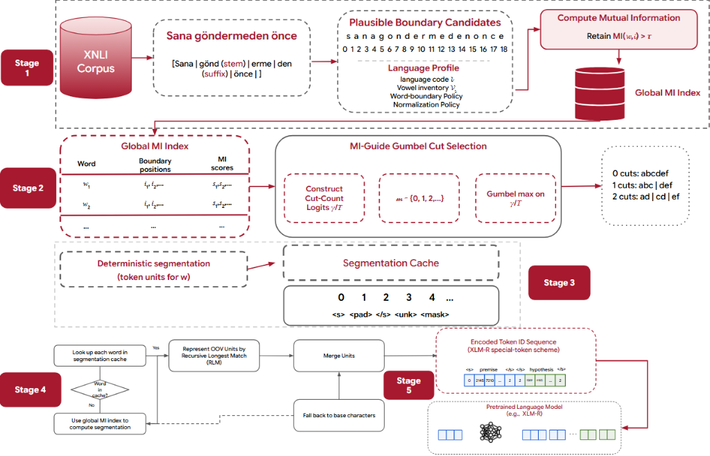

# Mind the Morphology: Morphology-Aware Tokenizer Adaptation under Constrained Fine-Tuning
[](LICENSE)

A morphology-aware tokenization framework that utilizes corpus-level mutual information to rank structurally plausible prefix--suffix decompositions and Gumbel-max sampling to control cut granularity, backed by deterministic caching for reproducible runtime inference.

> This repository contains the official implementation and reproduction artifacts for the paper:  
> **Mind the Morphology: Morphology-Aware Tokenizer Adaptation under Constrained Fine-Tuning**  
> Nhan Tran, Hung To, Hai Nguyen Thi Tuyet  
> *Proceedings of the 15th International Symposium on Information and Communication Technology (SOICT 2026)*  
> Oral Presentation | Paper ID: 3401

---

## Pretrained Tokenizers on Hugging Face

The official 32k-vocabulary tokenizers induced for the XNLI benchmark are available on the Hugging Face Hub:

| Language | ISO Code | Typological Family | Repository Link |
|---|---|---|---|
| Turkish | `tr` | Agglutinative (Turkic) | [NIRVLab/xnli-morphel-tr-32k](https://huggingface.co/NIRVLab/xnli-morphel-tr-32k) |
| Russian | `ru` | Fusional (Slavic) | [NIRVLab/xnli-morphel-ru-32k](https://huggingface.co/NIRVLab/xnli-morphel-ru-32k) |
| French | `fr` | Fusional (Romance) | [NIRVLab/xnli-morphel-fr-32k](https://huggingface.co/NIRVLab/xnli-morphel-fr-32k) |
| Vietnamese | `vi` | Isolating (Austroasiatic) | [NIRVLab/xnli-morphel-vi-32k](https://huggingface.co/NIRVLab/xnli-morphel-vi-32k) |
| Swahili | `sw` | Agglutinative (Bantu) | [NIRVLab/xnli-morphel-sw-32k](https://huggingface.co/NIRVLab/xnli-morphel-sw-32k) |
| Chinese | `zh` | Isolating (Sinitic) | [NIRVLab/xnli-morphel-zh-32k](https://huggingface.co/NIRVLab/xnli-morphel-zh-32k) |

---

## Method Overview

Standard subword tokenizers (such as BPE, WordPiece, and Unigram) optimize corpus compression statistics without explicitly respecting morphological boundaries. In morphologically rich languages, frequency-driven heuristics frequently oversegment stems or fuse inflectional affixes into uninformative fragments. MorpheL introduces a structured, five-stage adaptation pipeline designed to preserve root and affix stability under constrained fine-tuning.

<p align="center">
  
</p>

### Stage 1: Plausible Boundary Discovery & Mutual Information Indexing
- **Language Profile**: Each target language defines an orthographic profile containing its vowel inventory $\mathcal{V}_\ell$, word-boundary policy, and normalization rules.
- **Candidate Filtering**: For each orthographic word $w$, candidate cut positions $i$ are proposed based on consonant-vowel transitions and vowel harmony heuristics, pruning implausible character clusters.
- **Mutual Information Scoring**: Candidate bipartitions $(w_{<i}, w_{\ge i})$ are ranked via corpus-level Mutual Information:
  $$MI(w, i) = \log_2 \frac{P(w)}{P_{\text{pref}}(w_{<i}) \cdot P_{\text{suff}}(w_{\ge i})}$$
  Candidates satisfying $MI(w, i) > \tau$ (with default $\tau = 0.0$) are retained, prioritizing boundaries where prefix and suffix spans co-occur with high mutual statistical coherence.

### Stage 2: MI-Guided Gumbel Cut Selection
- **Logit Construction**: For each word, cut-count logits $\gamma = [0, s_1, (s_1 + s_2)/2]$ are computed for candidate cut counts $\{0, 1, 2\}$, where $s_1 \ge s_2$ are the top retained MI scores.
- **Controlled Granularity**: At exploration temperature $T > 0$, stochastic Gumbel-max sampling explores alternative cut counts. For persistent vocabulary induction and runtime encoding, deterministic argmax selection ($T = 0$) is enforced.

### Stage 3: Deterministic Caching & Vocabulary Induction
- **Segmentation Cache**: Canonical argmax segmentations are computed and frozen into a hash cache $\mathcal{S}_0$, mapping each word type to its deterministic sequence of morpheme-aligned pieces.
- **Span Extraction**: Vocabulary candidates include individual cached pieces and all contiguous piece spans, allowing high-frequency compound units to remain compact.
- **Fixed-Budget Construction**: The top $N$ most frequent units fill the target budget (32,000 tokens), followed by an automatic pass that appends any missing corpus characters to guarantee complete character coverage.

### Stage 4: Native Inference & Fallback
- **Cache Lookup**: In-vocabulary words are retrieved from $\mathcal{S}_0$ in $O(1)$ time.
- **Out-of-Vocabulary (OOV) Handling**: Unseen words are decomposed via on-the-fly MI boundary lookup. Any unresolved substrings fall back to Recursive Longest Match (RLM) against the induced vocabulary, followed by base characters if necessary.
- **Dynamic Programming Coalescing**: Consecutive pieces are merged using `DPCoalesce` to produce the minimum-token valid sequence under the vocabulary budget.

### Stage 5: Pretrained LM Integration
- Formats token sequences using the XLM-RoBERTa delimiter scheme: `<s> premise </s></s> hypothesis </s>`.
- Downstream representations are adapted under constrained regimes where the underlying transformer backbone remains frozen, testing the intrinsic quality of induced subword units.

---

## Experimental Setup & Arguments

### Corpus and Splits Protocol
- **Tokenizer Induction Corpus**: Unlabeled premise and hypothesis text from all splits (`train`, `validation`, and `test`) of the target-language XNLI dataset. Labels are strictly excluded from tokenizer training.
- **Downstream Fine-Tuning**: Evaluated on official XNLI classification splits (matched cross-lingual natural language inference into 3 classes: entailment, neutral, contradiction).

### Standard Hyperparameter Configuration

All standard MorpheL experiments share the following core parameters:

| Parameter | Flag | Standard Value | Description |
|---|---|---|---|
| Vocabulary Size | `--vocab-size` | `32000` | Target nominal subword vocabulary capacity |
| Minimum Frequency | `--min-frequency` | `2` | Minimum corpus occurrences for candidate piece inclusion |
| Top-$k$ Candidates | `--top-k` | `4` | Maximum positive-MI boundary candidates per word |
| MI Threshold | `--mi-threshold` | `0.0` | Minimum score threshold $\tau$ for candidate retention |
| Temperature | `--temperature` | `0.0` (or `1.0`) | Sampling temperature ($T=0$ for deterministic induction) |
| Max Sequence Length | `--model-max-length` | `512` | Maximum input length for transformer tokenizer |
| Random Seed | `--seed` | `42` | Random seed for deterministic reproducibility |

### Language-Specific Profiles

Each evaluated language employs an explicit profile configured in `configs/tokenizer/standard/`:

- **Turkish (`tr`)**: Vowel inventory `"aeiouAEIOUıİöüÖÜâîûÂÎÛ"`. Vowel boundary filter enabled (`use_vowel_boundary_filter: true`).
- **Russian (`ru`)**: Cyrillic vowel inventory `"аеёиоуыэюяАЕЁИОУЫЭЮЯ"`. Stochastic-consensus caching ($T = 1.0$, 24 samples, $\ge 40\%$ agreement threshold).
- **French (`fr`)**: Vowel inventory `"aeiouyAEIOUYàâéèêëîïôùûüÿÀÂÉÈÊËÎÏÔÙÛÜŸœŒ"`. Lexical anchoring retaining top 30,395 frequent pieces prior to MI induction.
- **Swahili (`sw`)**: Vowel inventory `"aeiouAEIOU"`. Vowel boundary filter enabled.
- **Vietnamese (`vi`)**: Full tonal vowel inventory (`a-y` with all five tone accents in precomposed NFC). Whitespace word boundary policy.
- **Chinese (`zh`)**: Character-level boundary policy (`use_vowel_boundary_filter: false`).

---

## Main Results

The table below reproduces the primary empirical finding of the paper: absolute XNLI classification performance across three fine-tuning regimes. Results are reported as mean $\pm$ standard deviation over three random seeds (all scores in %).

### Absolute XNLI Performance (Table 2 in Paper)

| Language | Metric | BPE | Unigram | WordPiece | MorpheL |
|---|---|---|---|---|---|
| **Regime A: Classifier-only (Backbone & Embeddings Frozen)** | | | | | |
| Turkish | Accuracy<br>Macro-F1 | 36.83 ± 0.33<br>32.60 ± 2.00 | 36.29 ± 0.39<br>28.97 ± 0.91 | 36.99 ± 0.16<br>33.24 ± 1.43 | **38.26 ± 0.32**<br>**36.04 ± 0.21** |
| Russian | Accuracy<br>Macro-F1 | 37.49 ± 0.41<br>34.67 ± 0.83 | 37.59 ± 0.32<br>34.50 ± 1.11 | 38.13 ± 0.47<br>36.57 ± 0.99 | **38.60 ± 0.55**<br>**37.80 ± 0.71** |
| French | Accuracy<br>Macro-F1 | 38.89 ± 0.57<br>37.52 ± 1.12 | **40.03 ± 0.73**<br>**38.39 ± 1.69** | 39.36 ± 0.66<br>38.14 ± 1.45 | 39.25 ± 0.89<br>38.27 ± 0.97 |
| Vietnamese | Accuracy<br>Macro-F1 | 37.57 ± 0.70<br>35.25 ± 1.21 | 37.19 ± 0.26<br>33.94 ± 0.27 | 35.64 ± 0.37<br>29.59 ± 1.75 | **37.68 ± 0.60**<br>**36.17 ± 1.63** |
| Swahili | Accuracy<br>Macro-F1 | 35.80 ± 0.25<br>29.52 ± 1.92 | 35.32 ± 0.11<br>26.89 ± 1.27 | 35.96 ± 0.36<br>28.70 ± 1.20 | **36.45 ± 0.21**<br>**32.53 ± 1.85** |
| Chinese | Accuracy<br>Macro-F1 | **37.86 ± 0.10**<br>35.14 ± 0.49 | 35.31 ± 0.14<br>27.73 ± 0.60 | 36.73 ± 0.64<br>32.74 ± 1.77 | 37.44 ± 0.25<br>**35.85 ± 1.13** |
| **Regime B: Embeddings & Classifier Trained (Backbone Frozen)** | | | | | |
| Turkish | Accuracy<br>Macro-F1 | 37.15 ± 0.53<br>32.63 ± 2.11 | 36.84 ± 0.36<br>29.53 ± 1.03 | 37.54 ± 0.34<br>33.64 ± 1.68 | **38.27 ± 0.46**<br>**36.06 ± 0.55** |
| Russian | Accuracy<br>Macro-F1 | 38.64 ± 0.55<br>36.67 ± 0.80 | 37.98 ± 0.19<br>35.41 ± 0.78 | 39.02 ± 0.60<br>37.66 ± 0.93 | **39.23 ± 0.46**<br>**38.57 ± 0.66** |
| French | Accuracy<br>Macro-F1 | 40.26 ± 0.42<br>38.99 ± 0.84 | **41.38 ± 1.09**<br>40.27 ± 1.48 | 41.29 ± 0.83<br>**40.40 ± 1.55** | 40.34 ± 0.43<br>39.67 ± 0.49 |
| Vietnamese | Accuracy<br>Macro-F1 | 39.11 ± 1.20<br>36.98 ± 1.73 | **39.33 ± 0.13**<br>36.45 ± 0.35 | 37.48 ± 0.81<br>32.33 ± 1.62 | 38.86 ± 0.57<br>**36.86 ± 1.55** |
| Swahili | Accuracy<br>Macro-F1 | 36.10 ± 0.50<br>29.20 ± 1.57 | 35.53 ± 0.19<br>27.65 ± 1.21 | 36.25 ± 0.52<br>28.81 ± 1.70 | **36.52 ± 0.15**<br>**32.68 ± 1.42** |
| Chinese | Accuracy<br>Macro-F1 | **38.22 ± 0.36**<br>**36.30 ± 1.15** | 34.52 ± 0.48<br>25.21 ± 2.66 | 38.08 ± 0.39<br>33.99 ± 1.39 | 37.84 ± 0.17<br>33.25 ± 0.55 |
| **Regime C: Full Fine-Tuning** | | | | | |
| Turkish | Accuracy<br>Macro-F1 | 69.76 ± 0.32<br>69.70 ± 0.37 | 70.13 ± 0.19<br>70.06 ± 0.22 | **70.25 ± 0.41**<br>**70.21 ± 0.42** | 68.83 ± 0.07<br>68.79 ± 0.08 |
| Russian | Accuracy<br>Macro-F1 | 70.74 ± 0.49<br>70.70 ± 0.51 | 70.91 ± 0.36<br>70.91 ± 0.39 | **71.27 ± 0.08**<br>**71.25 ± 0.10** | 69.51 ± 0.12<br>69.49 ± 0.12 |
| French | Accuracy<br>Macro-F1 | 75.65 ± 0.44<br>75.64 ± 0.44 | 75.02 ± 0.20<br>74.99 ± 0.21 | **76.75 ± 0.30**<br>**76.76 ± 0.33** | 74.66 ± 0.22<br>74.67 ± 0.22 |
| Vietnamese | Accuracy<br>Macro-F1 | **71.04 ± 0.24**<br>**71.01 ± 0.26** | 69.11 ± 0.56<br>69.07 ± 0.61 | 65.83 ± 0.20<br>65.79 ± 0.20 | 70.67 ± 0.03<br>70.63 ± 0.06 |
| Swahili | Accuracy<br>Macro-F1 | 61.59 ± 0.18<br>61.29 ± 0.23 | **62.24 ± 0.10**<br>**62.04 ± 0.11** | 62.06 ± 0.32<br>61.73 ± 0.31 | 61.03 ± 0.08<br>60.78 ± 0.12 |
| Chinese | Accuracy<br>Macro-F1 | 66.91 ± 0.57<br>66.89 ± 0.59 | 66.59 ± 0.07<br>66.58 ± 0.04 | 71.46 ± 0.18<br>71.43 ± 0.22 | **71.64 ± 0.54**<br>**71.68 ± 0.57** |

### Key Findings
1. **Morphological Advantage under Constrained Tuning**: In Regime A (frozen encoder and frozen embeddings, where only the linear classification head is trained), MorpheL outperforms all standard subword baselines on Turkish (+2.80 Macro-F1 over WordPiece), Swahili (+3.83 Macro-F1 over WordPiece), and Russian (+1.23 Macro-F1 over WordPiece).
2. **Persistence across Representation Adaptation**: In Regime B (where replacement embeddings are tuned alongside the classifier), MorpheL preserves its advantage on agglutinative and morphologically rich languages.
3. **Full Fine-Tuning Convergence**: In Regime C (unconstrained end-to-end parameter updates), conventional frequency-based tokenizers catch up or slightly surpass MorpheL, demonstrating that morphology-aware tokenization provides its primary utility under resource- and compute-constrained adaptation scenarios.

---

## Installation

MorpheL requires Python 3.9+ and can be installed in editable mode using `pip`:

```bash
git clone https://github.com/HeyDunaX/MorpheL.git
cd morphel
pip install -e .
```

To install optional dependencies for downstream evaluation and significance testing:

```bash
pip install -e ".[downstream,stats]"
```

---

## Reproduction Instructions

### Option 1: Reproduction via YAML Configuration (Recommended)

Pre-built YAML configuration files matching the exact paper setups are provided in `configs/tokenizer/standard/`.

```bash
# Turkish (32k vocabulary, vowel harmony filter)
morphel train-tokenizer --config configs/tokenizer/standard/turkish.yaml

# Russian (32k vocabulary, Cyrillic vowel inventory)
morphel train-tokenizer --config configs/tokenizer/standard/russian.yaml

# French (32k vocabulary, accented inventory)
morphel train-tokenizer --config configs/tokenizer/standard/french.yaml

# Vietnamese (32k vocabulary, NFC vowel inventory)
morphel train-tokenizer --config configs/tokenizer/standard/vietnamese.yaml

# Swahili (32k vocabulary, Latin vowel inventory)
morphel train-tokenizer --config configs/tokenizer/standard/swahili.yaml

# Chinese (32k vocabulary, character-level boundary policy)
morphel train-tokenizer --config configs/tokenizer/standard/chinese.yaml
```

### Option 2: Reproduction via Direct CLI Arguments

Each language configuration can also be invoked directly with full command-line arguments:

```bash
# Train Turkish MorpheL Tokenizer
morphel train-tokenizer \
    --dataset facebook/xnli \
    --subset tr \
    --language tr \
    --vowels "aeiouAEIOUıİöüÖÜâîûÂÎÛ" \
    --splits train \
    --splits validation \
    --splits test \
    --eval-splits validation \
    --eval-splits test \
    --text-columns premise \
    --text-columns hypothesis \
    --vocab-size 32000 \
    --min-frequency 2 \
    --top-k 4 \
    --temperature 0.0 \
    --mi-threshold 0.0 \
    --seed 42 \
    --output-dir outputs/tokenizers/morphel-tr-32k
```

### Inspecting and Encoding with Saved Artifacts

```bash
# Inspect tokenizer configuration and vocabulary stats
morphel inspect-tokenizer --tokenizer-dir outputs/tokenizers/morphel-tr-32k

# Test native morphological encoding
morphel encode \
    --tokenizer-dir outputs/tokenizers/morphel-tr-32k \
    --text "Sana göndermeden önce bazı haberler aldım."
```

### Python API Usage

```python
from morphel.serialization import load_native_tokenizer
from morphel.native_tokenizer import encode_sentence_as_tokens

# Load native artifacts (vocabulary, MI index, deterministic cache, Hugging Face wrapper)
artifacts = load_native_tokenizer("outputs/tokenizers/morphel-tr-32k")

# Segment text using native MorpheL logic
text = "Sana göndermeden önce bazı haberler aldım."
tokens = encode_sentence_as_tokens(
    text,
    vocabulary=artifacts["vocabulary"],
    mi_index=artifacts["mi_index"],
    segmentation_cache=artifacts["segmentation_cache"],
    top_k=artifacts["config"].top_k,
)
print(tokens)
```

---

## Output Artifacts

Each tokenizer run produces self-contained reproducibility artifacts in `--output-dir`:

```
outputs/tokenizers/morphel-tr-32k/
├── morphel_vocab.json           # Native MorpheL vocabulary mapping
├── mi_index.pkl                 # Precomputed corpus-level MI boundary index
├── segmentation_cache.pkl       # Deterministic T=0 segmentation cache
├── morphel_config.json          # Complete serialized hyperparameters
├── morphel_metrics_report.json  # Intrinsic evaluation metrics (fertility, length, shatter rate)
├── run_metadata.json            # Environment, git commit, and execution timestamps
├── tokenizer.json               # Hugging Face fast tokenizer definition
└── tokenizer_config.json        # Hugging Face tokenizer configuration
```

---

## Repository Structure

```
.
├── configs/                     # Exact reproduction YAML configuration files
│   ├── downstream/              # Regime A, B, and C fine-tuning configurations
│   ├── significance/            # Paired bootstrap and McNemar test configurations
│   └── tokenizer/               # Standard language configs (tr, ru, fr, vi, sw, zh)
├── figures/                     # Architecture diagram and figures
│   └── morphel_tokenizer.png
├── metadata/                    # Paper and repository metadata
│   ├── paper.yaml
│   └── repositories.yaml
├── pyproject.toml               # Package definition and pinned dependencies
├── src/morphel/                 # Core implementation
│   ├── cli.py                   # Typer CLI entrypoint
│   ├── config.py                # Hyperparameter dataclasses
│   ├── datasets.py              # Hugging Face corpus extraction
│   ├── preprocessing.py         # Word extraction and frequency statistics
│   ├── boundaries.py            # Orthographic and vowel-transition filters
│   ├── mi.py                    # Corpus-level Mutual Information indexing
│   ├── sampling.py              # Gumbel-max cut sampling logic
│   ├── vocabulary.py            # Contiguous-span vocabulary induction
│   ├── coalescing.py            # Dynamic programming piece coalescing
│   ├── fallback.py              # Recursive Longest Match (RLM) for OOV pieces
│   ├── native_tokenizer.py      # End-to-end tokenizer lifecycle orchestrator
│   ├── metrics.py               # Intrinsic tokenizer evaluation metrics
│   └── serialization.py         # Artifact serialization and HF wrapper
└── tests/                       # Unit, integration, and regression test suite
```

---

## Reproducibility & Determinism

- **Deterministic Caching**: All downstream evaluations freeze canonical $T=0$ maximum-likelihood cut boundaries in `segmentation_cache.pkl`, preventing sampling drift between training and inference.
- **Fixed Random Seeds**: Gumbel noise sampling (when $T > 0$) and tie-breaking algorithms enforce fixed random seeds.
- **Pinned Dependencies**: Dependency specifications are locked via `pyproject.toml` and `uv.lock`.

---

## Ethics Statement

This research uses publicly available benchmark datasets from the Cross-lingual Natural Language Inference (XNLI) repository. Tokenizer induction relies exclusively on the raw text of the target languages without demographic labels, personal identity attributes, or user annotations. We encourage practitioners to inspect morphological biases when deploying tokenizers to specialized low-resource linguistic varieties.

---

## License

This project is licensed under the MIT License. See the [LICENSE](LICENSE) file for details.

---

## Citation

If you use MorpheL in your research or reproduce its findings, please cite:

```bibtex
@inproceedings{tran2026mind,
    title = "{Mind the Morphology: Morphology-Aware Tokenizer Adaptation under Constrained Fine-Tuning}",
    author = "Tran, Nhan and To, Hung and Nguyen Thi Tuyet, Hai",
    booktitle = "{Proceedings of the 15th International Symposium on Information and Communication Technology (SOICT 2026)}",
    year = "{2026}",
    note = "Oral Presentation, Paper ID: 3401"
}
```

---

## References

1. Conneau, A., Khandelwal, K., Goyal, N., Chaudhary, V., Wenzek, G., Guzmán, F., Grave, E., Ott, M., Zettlemoyer, L., Stoyanov, V.: Unsupervised cross-lingual representation learning at scale. In: Proceedings of ACL, pp. 8440–8451 (2020)
2. Conneau, A., Rinott, R., Lample, G., Williams, A., Bowman, S.R., Schwenk, H., Stoyanov, V.: XNLI: Evaluating cross-lingual sentence representations. In: Proceedings of EMNLP, pp. 2475–2485 (2018)
3. Creutz, M., Lagus, K.: Unsupervised models for morpheme segmentation and morphology learning. ACM TSLP 4(1), 1–34 (2007)
4. Greenberg, J.H.: A quantitative approach to the morphological typology of language. IJAL 26(3), 178–194 (1960)
5. Kudo, T.: Subword regularization: Improving neural network translation models with multiple subword candidates. In: Proceedings of ACL, pp. 66–75 (2018)
